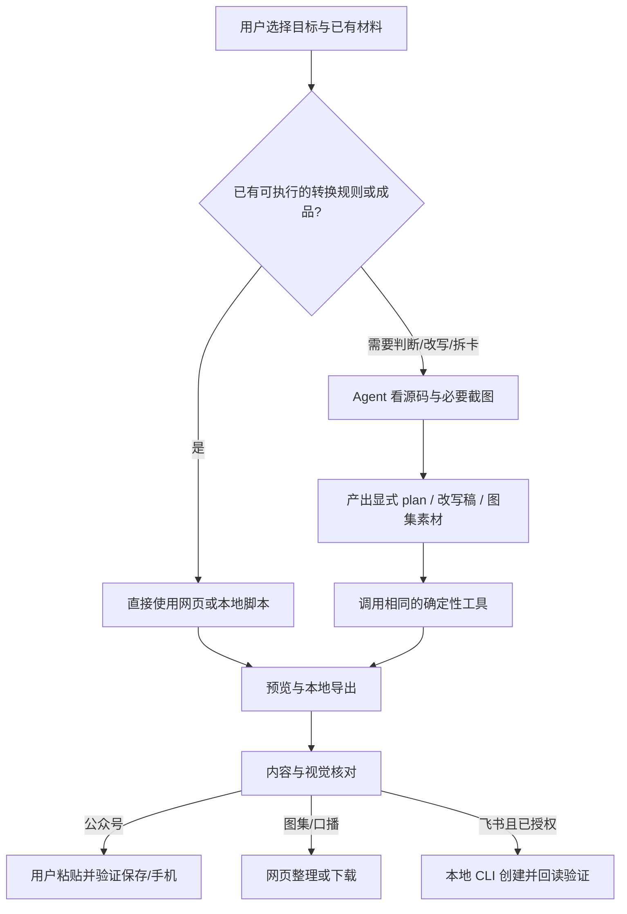

# 网页直用与 Agent 辅助：业务路径及入口方案

2026-10-31：首页已按此定位完成本地调整，提供两条路径、四场景入口与安装使用指引；未部署或同步 Hub，也未增加模型调用、密钥或飞书鉴权服务。

## 两个判断轴

**是否需要 LLM**，取决于是否要理解视觉、选择内容、改写、拆卡或补述。**在哪里执行**，取决于运行依赖、鉴权和资源访问。

因此，Skill 不等于 LLM，网页也不等于完整转换器。Skill 可以只调用脚本；飞书简单 HTML→XML 可以没有 LLM，但云端创建仍需 CLI 和账号。Agent 也可以仅负责选择/调用已有脚本，而不重写内容。

| 操作 | 需要 LLM？ | 当前执行位置 | 网页入口应承诺什么 |
|---|---|---|---|
| 标准 HTML→公众号富文本 | 不需要 | richtext 浏览器脚本；或本地 CLI | 直接转换、预览、复制；最终公众号兼容性另验 |
| 动画/切页/复杂视觉→公众号 | 需要先判断应保留和展开的状态 | Agent 看源码/图→plan→同一转换器 | “复杂页面交给 Agent”，而非网页自动理解全部状态 |
| 已有图片+文案→图集整理 | 不需要 | images 网页接收 payload | 预览、排序、复制、ZIP；不承诺网页生图 |
| 长文→AI 图集 | 需要：拆卡、prompt、逐张核验；生成还需生图工具 | Agent + 宿主生图工具→payload | “让 Agent 生成图集”；结果回到 images 页 |
| 已有口播稿→预览/统计/下载 | 不需要 | script 网页 | 预览已有 Markdown；不承诺 HTML→口语化 |
| HTML→Markdown 提取稿 | 不需要 | 本地 Node 脚本 | 可在本地工具路径执行；尚未做成浏览器 HTML 输入功能 |
| HTML→成品口播稿 | 需要：图表补述、口语化、切段与核对 | Agent→提取脚本→改写→Markdown | “让 Agent 改写”；成品回到 script 页 |
| 标准 HTML→原生 DocxXML | 不一定 | 本地脚本 | 展示本地使用说明；页面不直接创建飞书文档 |
| 复杂 HTML→合适原生块 | 需要：callout/grid/图表/截图边界 | Agent plan→本地转换 | Agent 处理后导出，授权后 CLI 创建 |
| 完整 HTML→HTML 内容块资源包 | 标准打包不需要；选择交付路线需人或 Agent 判断 | 本地脚本 | 明确它是展示网页，而非原生文字协作；页面不代做鉴权 |

## GitHub Pages 的职责

Pages 继续只发布 `web/`，提供确定性的浏览器工具、结果展示和使用指南。它不运行 Agent，不因用户点击“Agent 辅助”而自动获得 API key，也不承担飞书 token 或图片托管。

Agent 路径的交付物是文件或既有协议：公众号转换后的 HTML、口播 Markdown、图集 payload、飞书 XML/资源包。网页不是两个系统中的第二套转换引擎，而是能运行部分脚本、并接收 Agent 结果的交付界面。

## 已确认的首页定位与入口方案

首页定位已确认：四种能力/场景介绍 + CLI/Skill 安装使用引导 + 可直接使用的基础工具入口。保留已经批准的四平台卡片和视觉语言，将能力在文案和动作上分清。复杂内容可直接走 Agent，不必先在网页失败一次；使用同一转换器，不称为另一套“二次转换引擎”。

首页增加两条说明/导航：

- **网页直接使用**：无需 Agent，打开当前可在浏览器完成的操作。
- **Agent / 本地工具处理**：先用 Skill 理解或执行本地工具，再回到网页查看结果；不意味着每次都要调用 LLM。

| 平台卡片 | 直接操作（主按钮） | 需内容判断时的动作（次按钮/说明） |
|---|---|---|
| 公众号 | 开始基础转换 | 复杂页面：交给 Agent；带上原 HTML、目标和完整性要求 |
| 图集 | 查看示例 / 预览已有图集 | 从长文生成图集：安装 Skill 并交给 Agent |
| 口播稿 | 预览已有口播稿 | 从 HTML 提取并改写：交给 Agent |
| 飞书 | 查看本地转换与导出说明 | Agent 分析复杂版式；明确原生块或 HTML 内容块 |

不能给飞书加一个实际不存在的“在线创建”按钮；也不能将口播稿“预览”写成“开始 HTML 转换”。图集重生按钮仍只复制提示词，不伪装成网页内生成。

首页现已提供对应 Skill 安装步骤、四种可复制任务、输入/输出说明与结果页入口。安装区明确标注开发版发布状态，避免旧版源码缺少安装器造成误导。新增样式只作用于首页，保留米色卡片、细边框和原插画；无新增在线模型服务。

## 何时建议转交 Agent

代码可以发现信号并提醒：隐藏正文、透明入场动画、多个内容面板、SVG 引用变化、图表/表格丢失、复杂布局降级。它不能仅凭信号就判断“展开哪个面板”或“哪张图可删除”。

本轮 CampVenture 实测：基础转换保留 166 个标题，但 138 个标题受隐藏或透明样式影响。确定原文 15 个 tab 面板都是研究正文后，Agent 用显式 unwrap/remove plan 展开面板并删除控件，仍用原来的转换器执行。这是“同一功能有基础与辅助路径”的具体例子，不是新建第二套转换器。

检测信息应以温和的完整性提醒呈现，保留手动检查和继续使用的空间，不强制把所有 HTML 上传给模型，不自动调用模型或产生费用。

## 输入与交付边界

- 本地文件可在用户机器处理；公开 URL 的读取也不等于私有文件上传授权。
- Pages 上的 fragment 是编码，不是加密；Agent 默认交付本地文件，用户明确选择分享时再处理公开范围。
- 生图、素材托管、飞书创建和最终发布分别依照对象与范围授权。当前“先本地验证”仅运行本地输出和 dry-run，不包含部署或 Hub 同步。
- 技术通过、LLM 内容核对、平台保存重开和手机效果分别报告。
